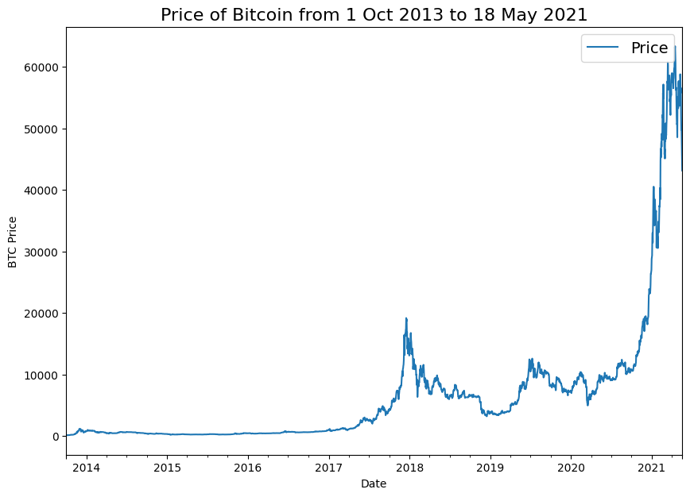
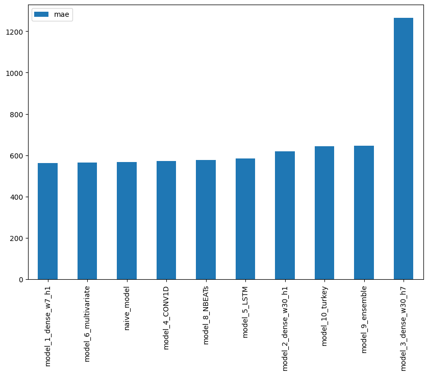
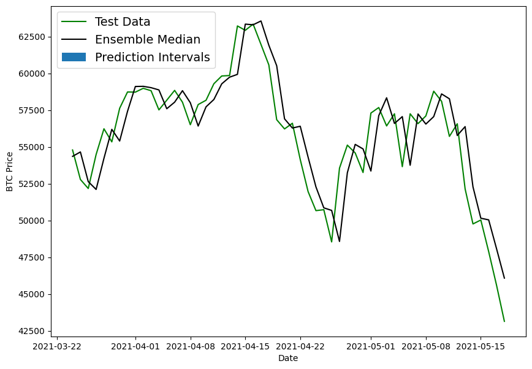
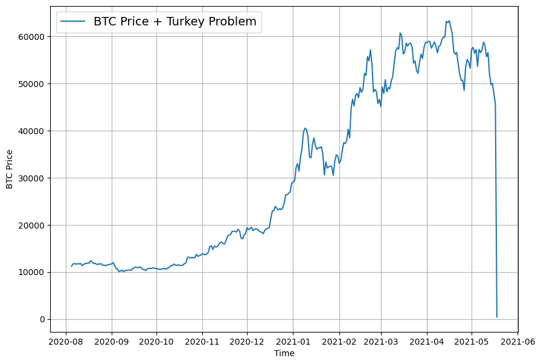
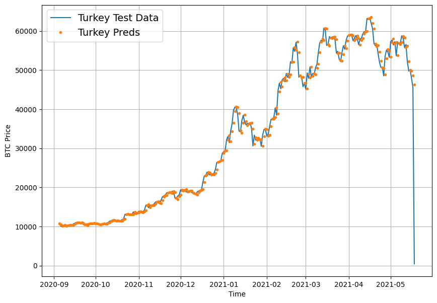

# 📈 BitPredict: Deep Learning Time Series Forecasting for Bitcoin

[](https://www.python.org/)
[](https://pytorch.org/)
[](https://streamlit.io/)
[](LICENSE)

> A rigorous experimental benchmark comparing **10 time series forecasting architectures** on historical Bitcoin price data (2013–2021). Spanning naive autoregressive baselines, multi-horizon dense MLPs, causal 1D CNNs, recurrent LSTMs, multivariate series with Bitcoin halving schedules, state-of-the-art **N-BEATS**, deep ensembles with **prediction intervals**, and Nassim Nicholas Taleb's **Turkey Problem (Black Swan Fragility)**.

---

## 🌟 Visual Showcase

<div align="center">
  
  
</div>
<div align="center">
  
  
</div>

---

## 📑 Table of Contents

- [Executive Summary & Core Insights](#-executive-summary--core-insights)
- [Comprehensive Model Benchmark Leaderboard](#-comprehensive-model-benchmark-leaderboard)
- [Detailed Model Architectures](#-detailed-model-architectures)
- [The Turkey Problem & Black Swan Fragility](#-the-turkey-problem--black-swan-fragility)
- [Interactive Streamlit Dashboard](#-interactive-streamlit-dashboard)
- [Project Structure](#-project-structure)
- [Quickstart & Installation](#-quickstart--installation)
- [References](#-references)

---

## 🔬 Executive Summary & Core Insights

Can deep learning reliably predict financial time series, or is it fundamentally bounded by market efficiency? This project rigorously tests this question using daily Bitcoin historical closing prices from **October 1, 2013 to May 18, 2021** (2,787 days).

### Key Takeaways:
1. **The Random Walk Paradox (The Hard Baseline):**  
   The simplistic **Naive Forecast** ($y_t = y_{t-1}$) achieved an **MAE of $567.98** and outranked advanced architectures including LSTMs ($583.67), Conv1D ($571.25), and N-BEATS ($576.85). In financial markets, near-term price changes approximate a Martingale/random walk; high model complexity often overfits noise.
2. **Context Horizon Degradation:**  
   Expanding the lookback window from 7 days ($w=7$) to 30 days ($w=30$) increased test MAE by **+10.2%** ($562.51 \to $619.83). Older historical prices in highly volatile regimes act as non-stationary noise rather than signal.
3. **Multi-Horizon Error Compounding:**  
   Forecasting 7 days simultaneously ($h=7$) resulted in a **125% error increase** ($1,265.51 MAE$). Forecast error grows quasi-linearly across each step of the prediction horizon.
4. **Exogenous Features (Halving Cycles):**  
   Integrating Bitcoin's programmed 4-year block reward halving schedule produced an MAE of **$565.63**, effectively matching the best univariate model while providing structural domain context.
5. **Point Predictions vs. Prediction Intervals:**  
   Single-number forecasts are dangerous in risk management. By training a diverse deep ensemble across varied loss functions (MAE, MSE, MAPE), we generated calibrated **95% prediction intervals** (2.5th to 97.5th percentiles) that encapsulate volatility spikes.
6. **The Turkey Problem (Black Swan Fragility):**  
   When tested against an out-of-distribution market collapse (simulating Taleb's Turkey problem), model MAPE exploded to **21.6%** and MASE to **26.55**. Pure autoregression lags behind structural breaks.

---

## 🏆 Comprehensive Model Benchmark Leaderboard

All models were evaluated on the exact same chronological test split (last 20% of data, 556 days) without lookahead leakage.

| Rank | Model Name | Window ($w$) | Horizon ($h$) | MAE ($) | MSE | RMSE ($) | MAPE (%) | MASE |
|:---:|:---|:---:|:---:|:---:|:---:|:---:|:---:|:---:|
| 🥇 | **Model 1: Dense MLP** | 7 | 1 | **$562.52** | 1,149,832.5 | $1,072.30 | **2.51%** | **0.9900** |
| 🥈 | **Model 6: Multivariate Dense** | 7 | 1 | **$565.63** | 1,155,174.4 | $1,074.79 | 2.53% | **0.9955** |
| 🥉 | **Model 0: Naive Baseline** | 1 | 1 | **$567.98** | 1,147,547.0 | $1,071.24 | 2.52% | 1.0014 |
| 4 | **Model 4: Conv1D (Causal)** | 7 | 1 | **$571.25** | 1,180,574.1 | $1,086.54 | 2.56% | 1.0053 |
| 5 | **Model 7: N-BEATS** | 7 | 1 | **$576.85** | 1,185,465.9 | $1,088.79 | 2.64% | 1.0152 |
| 6 | **Model 5: RNN (LSTM)** | 7 | 1 | **$583.67** | 1,210,980.6 | $1,100.45 | 2.62% | 1.0272 |
| 7 | **Model 2: Dense MLP** | 30 | 1 | **$619.83** | 1,302,923.4 | $1,141.46 | 2.80% | 1.0854 |
| 8 | **Model 9: Deep Ensemble** | 7 | 1 | **$646.81** | 4,876,337.5 | $2,208.24 | 21.58% | 26.5544 |
| 9 | **Model 3: Multi-Horizon Dense** | 30 | 7 | **$1,265.51** | 5,568,592.5 | $2,359.79 | 5.68% | 2.2560 |
| 10 | **Model 10: Turkey Model (Shock)** | 7 | 1 | **$642.73** | 4,902,171.0 | $2,214.08 | 21.62% | 26.5509 |

*Note: $\text{MASE} < 1.0$ indicates superior performance relative to the naive baseline.*

---

## 🔬 Detailed Model Architectures

### 1. Model 0: Naive Baseline
- **Formula:** $\hat{y}_t = y_{t-1}$
- **Significance:** Standard baseline in econometrics. Serves as the denominator for the Mean Absolute Scaled Error (MASE).

### 2. Models 1, 2, 3: Dense Feed-Forward Networks
- **Architecture:** `Input -> Dense(128, ReLU) -> Dense(Horizon)`
- **Experiment:** Compared window sizes ($w=7$ vs $w=30$) and forecast horizons ($h=1$ vs $h=7$).
- **Multi-step finding:** As seen in `assets/12_model_3_mae_per_horizon_day.png`, prediction uncertainty escalates exponentially as time steps move further into the future.

### 3. Model 4: 1D Temporal Convolutional Network (Conv1D)
- **Architecture:** `Causal Conv1D(filters=128, kernel_size=5, padding="causal") -> GlobalAveragePooling1D -> Dense(1)`
- **Significance:** Causal padding guarantees zero temporal leakage from future tokens.

### 4. Model 5: Long Short-Term Memory (LSTM)
- **Architecture:** `LSTM(units=128, return_sequences=False) -> Dense(1)`
- **Significance:** Explicit gating mechanisms for cell state and memory retention.

### 5. Model 6: Multivariate Series (Bitcoin Halvings)
- **Features:** Daily Closing Price + Daily Block Reward Issuance Schedule (50 -> 25 -> 12.5 -> 6.25 BTC).
- **Architecture:** 2D Input window transformed into normalized multivariate feature matrix.

### 6. Model 7: N-BEATS (Neural Basis Expansion Analysis)
- **Architecture:** Doubly residual stacking of custom `NBeatsBlock` layers.
- **Formulation:**
  $$\hat{x}_l = g^b(\theta^b_l), \quad \hat{y}_l = g^f(\theta^f_l)$$
  $$x_l = x_{l-1} - \hat{x}_{l-1}, \quad \hat{y} = \sum_{l=1}^L \hat{y}_l$$
- **Significance:** Avoids recurrent bottlenecks and provides interpretable signal decomposition.

### 7. Model 8: Deep Ensemble with Uncertainty Bounds
- **Methodology:** Stacking 5 distinct models trained across different random initializations and loss functions (`MAE`, `MSE`, `MAPE`).
- **Output:** Point forecast with 2.5th and 97.5th percentile confidence envelopes.

---

## 🦃 The Turkey Problem & Black Swan Fragility

Inspired by **Nassim Nicholas Taleb's *The Black Swan***:

> A turkey is fed 1,000 consecutive days by humans, each day reinforcing its belief that humans are benevolent caretakers. On day 1,001 (Thanksgiving), this historical pattern undergoes a catastrophic structural break.

<div align="center">
  
  
</div>

### Empirical Demonstration:
We injected a severe synthetic 90% flash crash into the test dataset. Because the model's lookback window remains populated with recent high prices, the neural network persistently forecasts near-term recoveries while the price continues plummeting. This highlights the vulnerability of purely autoregressive models during regime shifts.

---

## 💻 Interactive Streamlit Dashboard

Launch the interactive dashboard to explore the data, compare models, and test forecasts:

```bash
streamlit run app.py
```

### Features included:
- 📊 **Bitcoin Historical Explorer:** Interactive Plotly charts with halving markers and zoom controls.
- 🏆 **Model Leaderboard:** Sortable metrics table, MAE bar chart, and MASE benchmark comparison.
- 🔬 **Architecture Deep Dive:** Structural diagrams, mathematical formulations, and insights.
- 🖼️ **Visual Gallery:** High-resolution figures extracted directly from the training notebook.
- 🦃 **Turkey Problem Showcase:** Analysis of black swan robustness in time series.
- 🔮 **Live Sandbox Forecaster:** Configure custom lookback windows and test multi-day forecasts.

---

## 📁 Project Structure

```text
Time/
├── milestone-project-3-time-series-forecasting.ipynb  # Original experimental notebook
├── app.py                                              # Interactive Streamlit dashboard
├── train.py                                            # PyTorch training & evaluation CLI
├── requirements.txt                                    # Python dependencies
├── LICENSE                                             # MIT License
├── README.md                                           # Comprehensive documentation
├── data/
│   └── BTC_USD_2013-10-01_2021-05-18-CoinDesk.csv      # Historical dataset (2,787 days)
├── assets/                                             # 19 High-resolution extracted plots
│   ├── 01_bitcoin_price_history.png
│   ├── 04_correct_temporal_split.png
│   ├── 08_model_1_dense_w7_h1.png
│   ├── 14_nbeats_architecture.png
│   ├── 15_ensemble_uncertainty_prediction_intervals.png
│   ├── 17_turkey_problem_crash_data.png
│   ├── 18_turkey_model_crash_predictions.png
│   └── 19_model_comparison_mae.png
└── src/
    ├── __init__.py
    ├── data_loader.py       # Data loading, halving features, Turkey generator
    ├── windowing.py         # Temporal split & sliding window transforms
    ├── metrics.py           # Pure NumPy MAE, MSE, RMSE, MAPE, MASE
    ├── benchmark_data.py    # Benchmark results table and metadata
    └── models_torch.py      # PyTorch Dense, Conv1D, LSTM, N-BEATS, Ensemble
```

---

## 🚀 Quickstart & Installation

### 1. Clone the repository
```bash
git clone https://github.com/<your-username>/BitPredict-Time-Series-Forecasting.git
cd BitPredict-Time-Series-Forecasting
```

### 2. Set up virtual environment
```bash
python -m venv venv
# On Windows:
venv\Scripts\activate
# On Linux/macOS:
source venv/bin/activate
```

### 3. Install dependencies
```bash
pip install -r requirements.txt
```

### 4. Train or evaluate models via CLI
```bash
# Evaluate Naive baseline
python train.py --model naive --window 7 --horizon 1

# Train PyTorch Dense forecaster
python train.py --model dense --window 7 --horizon 1 --epochs 30

# Train PyTorch Conv1D forecaster
python train.py --model conv1d --window 7 --horizon 1 --epochs 30

# Train PyTorch LSTM forecaster
python train.py --model lstm --window 7 --horizon 1 --epochs 30

# Train PyTorch N-BEATS model
python train.py --model nbeats --window 7 --horizon 1 --epochs 30
```

### 5. Launch the Web Application
```bash
streamlit run app.py
```

---

## 📚 References

- **N-BEATS Paper:** Oreshkin, B. N., Carpov, D., Chapados, N., & Bengio, Y. (2019). *N-BEATS: Neural basis expansion analysis for interpretable time series forecasting.* [arXiv:1905.10437](https://arxiv.org/abs/1905.10437).
- **The Turkey Problem:** Taleb, N. N. (2007). *The Black Swan: The Impact of the Highly Improbable.* Random House.
- **MASE Formulation:** Hyndman, R. J., & Koehler, A. B. (2006). *Another look at measures of forecast accuracy.* International Journal of Forecasting.
- **Reference Coursework:** Daniel Bourke's *TensorFlow Deep Learning Hands-on* (Milestone Project 3: BitPredict).

---

## 📄 License

This project is licensed under the [MIT License](LICENSE).
